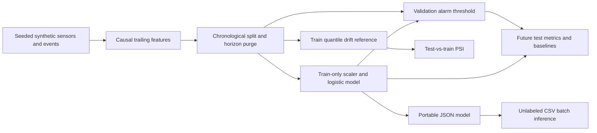

# Architecture and leakage contract

## At observation hour t

Features use current and past sensor observations `[t-11,t]`. The target is one if at least one event occurs at `(t,t+6]`. An event at the observation hour does not itself set that observation's label. No future sensor or event field enters the feature vector. Asset ID and time are metadata, not predictors.

For an 1,800-hour stream, training observations begin at hour 11 and end at 1073, with labels ending at 1079. Validation starts at 1080 and ends at 1433, with labels ending at 1439. Test observations begin at 1440 and end at 1793, with labels ending at 1799. Six observations at each boundary are purged because their labels require events from the following partition.

Historical observations from the preceding split may enter a trailing feature window at a later split's start: those readings are already available at prediction time. The protocol measures future observations on the **same assets**, not unseen-asset performance.

## Learning and comparison

The scaler uses training means and standard deviations only. Logistic regression minimizes binary cross-entropy plus L2 weight regularization with deterministic batch gradient descent. Hyperparameters are fixed in code; the alarm threshold is selected by validation F1, never by test scores.

The prevalence baseline uses the training event-target rate for every row. The sensor baseline maps the trailing temperature mean through a sigmoid after training-only z-scoring; its alarm cutoff is chosen on validation. It is a simple ranking heuristic, not a separately calibrated probability model.

Average precision and ROC-AUC group tied scores before computing curves. This prevents a constant-probability baseline from receiving spurious ranking credit due to row ordering. Single-class labels produce `null` for undefined ranking metrics.

## Drift

Quantile-bin internal edges and expected fractions are fitted on training features. Comparisons reuse those edges, with unbounded exterior bins and epsilon-smoothed fractions. PSI reports distribution changes; it does not prove model degradation or prescribe automatic retraining.

## Inference

The score command uses the identical feature builder with `labeled=False`. It requires no future observations and does not use failure labels as predictors or targets during scoring. If a failure-label column exists, CSV loading still parses and validates it; omitting that column is supported. The first eleven observations per asset are a warm-up. JSON artifacts avoid executable serialization; input shape and finite sensor values are validated.
